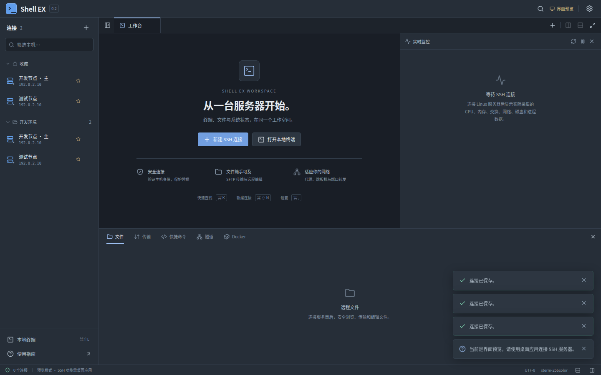

# Shell EX

个人专属的 SSH 桌面工作台：终端、文件、服务器状态和常用运维操作在同一个窗口完成。

**Tauri 2 · Rust / Tokio · React / TypeScript · xterm.js · Monaco**

当前版本：`0.3.0`（本地加密密码库、连接编辑页简化，以及 v0.2 工作台增强）。macOS Apple Silicon 为首发平台，同时提供 Windows x64 和 Linux x64 构建。产品功能按 M0–M5 实现；各平台的实际验证结果与发布条件见 [交付状态](docs/milestones/STATUS.md)，不能用代码存在代替验收结果。

**[下载 v0.3.0](https://github.com/xzcode/shell-ex/releases/tag/v0.3.0)** · [版本说明](docs/releases/v0.3.0.md) · [界面截图](docs/design/UI.md#v020-实际界面预览) · [安装与更新说明](docs/RELEASE.md)

v0.2.0 业务代码来源为 `f7c4d61f0bbea30b2251f051484a1852f0388be4`，三平台安装包须与这一提交对应，并提供 SHA-256 校验文件和构建记录。私有仓库附件需要相应 GitHub 权限；[v0.1.0 旧版](https://github.com/xzcode/shell-ex/releases/tag/v0.1.0) 仍予保留。



这是 v0.2.0 **真实浏览器界面预览**，处于未连接状态；主机地址属于 TEST-NET 测试数据，不是模拟成功 SSH。还可查看 [雾光浅色界面](docs/design/images/workbench-v0.2-mist.png)。真实 Linux 监控与 SFTP 目录树只有连接桌面应用的服务器后才会显示实际数据。

## 功能

| 工作域 | 已实现的能力 |
| --- | --- |
| 主机 | 分组、搜索、收藏、复制、配置编辑、SSH config 导入预览、加密迁移 |
| 终端 | SSH 密码/私钥/Agent/交互式认证，本地 PTY，多标签、上下/左右分屏、搜索、字体与主题、尺寸同步、重连 |
| 文件 | 底部全宽双栏 SFTP：懒加载目录树、文件表格（类型、时间、POSIX 权限、UID/GID）、多选、目录创建、重命名、权限修改、拖拽上传 |
| 传输 | 上传/下载、目录规划、覆盖策略、有界并发、真实进度、暂停/续传/取消、SHA-256 校验 |
| 编辑 | 本地 Monaco、UTF-8 文本、语法高亮、搜索替换、冲突检测、临时文件与原子替换、另存为 |
| 监控 | Linux CPU/趋势、内存、Swap、负载、内核、CPU 核数、挂载点、网卡流量曲线与进程列表；明确触发的信号操作 |
| 网络 | SOCKS5 / HTTP CONNECT、跳板、SSH 本地/远程/动态转发 |
| 运维 | 快捷命令、Docker 容器与镜像列表、日志、启动/停止/重启 |
| 数据 | SQLite 主机配置、应用内 Argon2id + AES-256-GCM 加密密码库、可选系统凭据库、加密备份、工作区布局恢复 |

不需要登录产品账号，不依赖自建服务端。程序不包含遥测或自动上传配置。

## 启动桌面应用

需要 Node.js 22+、Rust 1.100+ 和当前平台的 Tauri 开发依赖。macOS 需要 Xcode Command Line Tools；Windows 需要 MSVC C++ 工具链与 WebView2；Linux 需要 GTK 3 / WebKitGTK 4.1 开发包。

```bash
git clone https://github.com/xzcode/shell-ex.git
cd shell-ex/apps/desktop
npm ci
npm run tauri dev
```

只查看界面可运行 `npm run dev`。浏览器会明确显示“界面预览”：主机和设置可在预览中编辑，但不能建立 SSH、本地终端或执行文件操作，也不会保存密码。

## 第一次连接

1. 新建连接，填写主机、端口、用户名，选择密码、私钥、SSH Agent 或交互式认证。
2. 双击连接，核对服务器提供的 SHA-256 公钥指纹后确认信任。指纹变化不会自动接受。
3. 新建连接默认选择 Shell EX 本地加密密码库，首次保存时需设置至少 12 字符主密码，之后解锁即可自动连接。旧连接保持原系统凭据库模式；也可选择“仅本次使用”。
4. 终端打开后，底部可切换文件、传输、快捷命令、隧道和 Docker；右侧显示 Linux 状态。

私钥路径只保存引用。Agent 使用当前用户的系统 Agent，macOS/Linux 通过 `SSH_AUTH_SOCK`，Windows 通过 OpenSSH Agent 命名管道。配置跳板机时，先连接跳板，再连接目标。

普通 SSH 重连会打开新 shell；要让远程任务独立于网络连接，请在服务器上使用 `tmux` 等会话工具。工作区恢复记录配置与布局，不恢复已退出的远程进程。

## 打包

```bash
# 在 macOS 上打包 Apple Silicon 版本
cd apps/desktop
rustup target add aarch64-apple-darwin
npm run tauri -- build --target aarch64-apple-darwin --bundles app,dmg
```

Windows 使用 `--bundles nsis`，Linux 使用 `--bundles deb`。GitHub 的 **Desktop packages** 工作流会分别构建三个平台，默认将安装包、SHA-256 校验文件与构建来源保存在仓库 **Releases** 中的 `build-提交前12位` 草稿；工作流摘要提供入口。正式发布独立执行，普通 master 构建不会自动发布正式版，也不会覆盖已发布版本。当前 macOS 默认采用 ad-hoc 签名；开发者身份证书、公证与 Windows 代码签名需单独配置，详见 [发行说明](docs/RELEASE.md)。

## 必要验证

```bash
# 根目录：核心单元与认证协议测试
cargo test --locked -p shell-ex-core --lib --test auth_protocol

# 根目录：临时回环 OpenSSH，完成后清理；不连接个人服务器
python3 scripts/ssh_fixture.py cargo test --locked -p shell-ex-core \
  --test ssh_integration --test files_integration -- --ignored --test-threads=1

# 前端类型检查与生产构建
cd apps/desktop
npm run build
```

目录、编辑、续传、认证和转发都有实际行为测试。不同变更选择对应验证；不要求为文档或样式改动反复执行全部网络测试。

## 使用边界

- 编辑器只处理 UTF-8、最大 5 MiB 文本；非文本文件使用下载功能。
- 同一运行期可暂停/校验/续传；重启应用不会自动续传遗留任务。目录复制每次最多 1000 个文件，跳过符号链接并显示清单。
- 原文件替换依赖服务器的 OpenSSH `posix-rename` 扩展；不支持时返回明确错误，原文件保留。保留传统权限和 UID/GID，不复制 ACL/xattrs。
- SSH config 导入采用明确支持的字段子集，不执行 `Include`、`Match`、`ProxyCommand` 或本地命令；不支持的路由不会悄悄改成直连。
- 代理认证、旧算法兼容开关、云同步和 MCP 适配未纳入本版。普通 SSH 终端内仍可按服务器策略交互使用 `sudo`；文件面板不会自动提权。
- 签名更新的代码已接入；只有构建时配置可信公钥及 HTTPS 更新源才启用，默认构建不会请求未配置的更新服务。

## 文档导航

- [产品需求与验收](docs/product/PRD.md)
- [界面设计规范](docs/design/UI.md)
- [架构与技术决策](docs/architecture/ARCHITECTURE.md)
- [安全与数据约定](docs/SECURITY.md)
- [发行与升级](docs/RELEASE.md)
- [v0.3.0 版本说明](docs/releases/v0.3.0.md)
- [v0.2.0 版本说明](docs/releases/v0.2.0.md)
- [v0.1.0 版本说明](docs/releases/v0.1.0.md)
- [开发交接](docs/HANDOFF.md)
- [M0–M5 状态和验证](docs/milestones/STATUS.md)

本项目为个人定制软件。应用代码的使用授权见 `LICENSE`；依赖保留各自许可，见 `THIRD_PARTY_NOTICES.md`。
