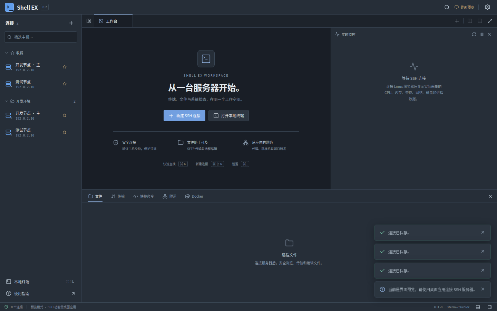

# Shell EX

[English](README.md) | **简体中文**

跨平台 SSH 桌面工作台，在同一个窗口管理服务器、终端、远程文件、传输及系统监控。

技术栈：**Tauri 2 · Rust / Tokio · React / TypeScript · xterm.js · Monaco**。

## 下载

从 [最新正式版本](https://github.com/xzcode/shell-ex/releases/latest) 获取安装包。Shell EX 无须注册账号或部署专用服务端。

| 平台 | 安装包 |
| --- | --- |
| macOS（Apple Silicon） | `.dmg` |
| Windows（x64） | `.exe`（NSIS） |
| Linux（x64） | `.deb` |

发行页面提供各平台安装包的 SHA-256 校验值及构建来源。参见 [全部版本](https://github.com/xzcode/shell-ex/releases) 和 [v0.4.14 版本说明](docs/releases/v0.4.14.md)。macOS 采用 ad-hoc 签名，未经过 Apple 公证；Windows 可能提示无法识别发布者。Linux 安装包面向兼容的 Debian 系发行版。

## 界面预览



上图为 v0.2.0 历史浏览器预览，处于未连接状态，主机为 TEST-NET 示例数据。另见 [雾光浅色预览](docs/design/images/workbench-v0.2-mist.png) 与 [界面设计规范](docs/design/UI.md)。当前版本包含七种主题以及进一步完善的监控和工作区功能。真实 SSH、SFTP 与 Linux 指标需通过桌面应用连接服务器。

## 功能

| 工作域 | 功能 |
| --- | --- |
| 主机管理 | 自定义分组（支持空分组）、收藏、搜索、复制/编辑连接、SSH config 导入预览、加密迁移 |
| 终端 | SSH 密码/私钥/Agent/交互式认证、本地 PTY、多标签、上下/左右分屏、搜索、重连、字体、主题、背景图、右键菜单 |
| 远程文件 | 底部双栏 SFTP、懒加载目录树、可排序及调整列宽的文件表格、文件属性、多选、创建、重命名、权限修改、拖拽上传 |
| 传输 | 上传/下载、目录规划、覆盖策略、有界并发、真实进度、暂停/续传/取消、SHA-256 校验 |
| 编辑 | Monaco 编辑器、UTF-8 文本、语法高亮、搜索替换、冲突检测、原子替换、另存为 |
| 监控 | 可分离/合并的 Linux 监控窗口；CPU、内存、Swap、负载、内核、网卡流量、去重后的本地/共享文件系统、磁盘读写速度、IOPS、使用率、延迟、队列深度、可排序搜索的进程列表及 CPU/RSS 排名 |
| 网络 | SOCKS5、HTTP CONNECT、跳板机、SSH 本地/远程/动态转发 |
| 运维 | 紧凑快捷命令、Docker 容器/镜像/日志/启动/停止/重启、主工作区内显式触发进程信号操作 |
| 个性化 | 七种主题（含中性灰、柔和白）、布局和列宽持久化、多语言界面 |
| 本地数据 | SQLite 连接配置、默认内置 AES-256-GCM 凭据加密（无须主密码）、旧版密码库兼容、加密备份、工作区恢复 |

不需要登录产品账号、部署专用后端或安装监控 Agent。配置保存在本地，不包含遥测或自动上传配置。默认凭据加密方式侧重使用便利性，不能抵御已能访问设备和应用文件的攻击者。

## 快速开始

1. 新建连接，填写主机、端口、用户名及认证方式。
2. 建立连接前核对服务器 SHA-256 公钥指纹并确认信任；指纹变化不会自动接受。
3. 选择默认的本地加密保存，或每次输入密码。旧连接保留原存储方式。
4. 打开终端，底部切换文件、传输、快捷命令、隧道和 Docker；打开 Linux 监控查看服务器指标。

私钥路径仅保存引用。SSH Agent 使用当前用户的 Agent：macOS/Linux 通过 `SSH_AUTH_SOCK`，Windows 通过 OpenSSH Agent 命名管道。跳板机先于目标主机连接。重连会打开新的远程 shell；如需让任务独立于网络连接运行，请在服务器使用 `tmux` 等工具。

## 源码开发

需要 Node.js 22+、兼容的 Rust 工具链及 [Tauri 开发依赖](https://v2.tauri.app/start/prerequisites/)。macOS 需要 Xcode Command Line Tools；Windows 需要 MSVC C++ 工具链与 WebView2；Linux 需要 GTK 3 / WebKitGTK 4.1 开发包。

```bash
git clone https://github.com/xzcode/shell-ex.git
cd shell-ex/apps/desktop
npm ci
npm run tauri dev
```

仅查看界面可运行 `npm run dev`。浏览器预览允许编辑示例主机与设置，但不能建立 SSH、本地终端或执行文件操作，也不会保存密码。

### 打包

```bash
# 从仓库根目录开始，在 macOS 上打包 Apple Silicon 版本
cd apps/desktop
rustup target add aarch64-apple-darwin
npm run tauri -- build --target aarch64-apple-darwin --bundles app,dmg
```

Windows 使用 `--bundles nsis`，Linux 使用 `--bundles deb`。[Desktop packages 工作流](https://github.com/xzcode/shell-ex/actions/workflows/desktop.yml) 为三个受支持的平台构建安装包。版本号变化或显式请求发布时，在必要产物验证后可正式发布；普通开发构建保留为草稿。历史构建记录、签名及升级说明见 [发行文档](docs/RELEASE.md)。

### 验证

```bash
# 仓库根目录：核心与认证协议测试
cargo test --locked -p shell-ex-core --lib --test auth_protocol

# 临时回环 OpenSSH，不连接个人服务器
python3 scripts/ssh_fixture.py cargo test --locked -p shell-ex-core \
  --test ssh_integration --test files_integration -- --ignored --test-threads=1

# 前端类型检查与生产构建
cd apps/desktop
npm run build
```

CI、浏览器回归测试、原生打包与真实设备验收分别记录，不能相互替代。详见 [Actions](https://github.com/xzcode/shell-ex/actions) 和各版本说明。

## 使用边界

- 编辑器支持最大 5 MiB 的 UTF-8 文本；非文本文件请下载。原子替换依赖服务器的 OpenSSH `posix-rename` 扩展；保留传统权限与 UID/GID，不复制 ACL/xattrs。
- 传输可在同一运行期内续传，重启应用不会自动恢复。目录复制每次最多 1000 个文件，跳过符号链接并提供清单。
- SSH config 导入支持明确的字段子集，不执行 `Include`、`Match`、`ProxyCommand` 或本地命令，不支持的路由不会自动改成直连。
- 文件面板不会自动提权；交互式 `sudo` 仍遵循远程服务器的权限策略。
- Linux 监控受 procfs/sysfs 及系统工具可用性限制；进程采集最多 10000 项且有传输字节上限。网络文件系统展示容量，但不采集 NFS 专属 I/O。初次采样或缺失指标不会伪造数值；独立监控窗口为只读。
- macOS 原生监控窗口分离/合并及部分剪贴板、文件选择交互仍需实机验收。
- 空分组及终端背景图属于本地偏好，旧版可移植备份格式不含这些信息。签名自动更新需配置可信公钥及 HTTPS 更新源，默认关闭。

## 文档导航

- [产品需求与验收](docs/product/PRD.md) · [界面设计](docs/design/UI.md) · [架构与技术决策](docs/architecture/ARCHITECTURE.md)
- [安全与数据约定](docs/SECURITY.md) · [发行与升级](docs/RELEASE.md) · [开发交接](docs/HANDOFF.md)
- [里程碑状态](docs/milestones/STATUS.md) · [版本说明](docs/releases/) · [GitHub Releases](https://github.com/xzcode/shell-ex/releases)

## 许可证

应用代码的使用授权见 [LICENSE](LICENSE)，依赖许可见 [THIRD_PARTY_NOTICES.md](THIRD_PARTY_NOTICES.md)。
