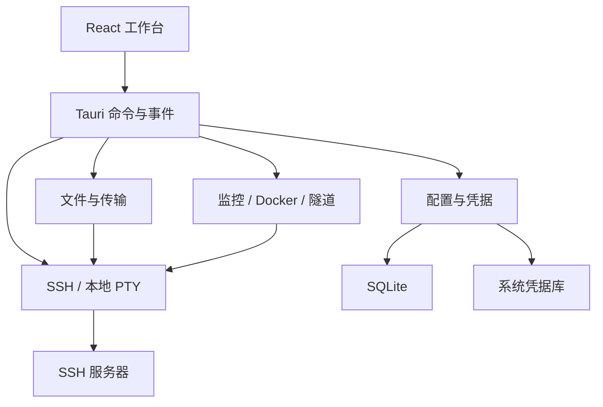

# Shell EX 架构与技术决策

## 边界

桌面 UI 位于 `apps/desktop/src`。Tauri 位于 `apps/desktop/src-tauri`，只负责系统入口、配置、类型化 IPC、系统对话框和生命周期。协议与业务逻辑位于独立的 `shell-ex-core` crate，可在不启动 WebView 的情况下验证。

首版把规划中的多个底层 crate 收敛成一个 core crate 内的独立模块，保留核心/UI 分离，避免只有几百行代码的模块之间形成复杂依赖。需要独立复用时可进一步拆 crate。

## 连接与生命周期

`SshManager` 管理带 UUID 的会话。每个交互式标签建立独立传输，SFTP、exec、监控和转发在该传输下使用独立 channel。初版优先保障标签关闭和错误隔离，而不把同主机的所有标签强制绑定为一个共享传输。

连接次序是：网络建立 → 主机公钥验证 → 用户认证 → PTY/shell → connected。探测不认证；真正认证时再次匹配刚核验的公钥，防止探测与连接之间被替换。服务连接 `connect_service` 不创建 PTY，可供测试及未来的独立跳板生命周期使用。

当前 UI 的跳板是已连接主机会话，目标通过 direct-tcpip 建立 SSH。关闭跳板会使依赖其传输的连接结束；不能承诺目标独立存活。每层仍有自己的主机指纹验证。

断开操作通过 cancellation token 通知读写与转发任务。关闭会话取消关联传输、隧道和监控采样。退出程序进行有界清理，本地 PTY 子进程被终止。连接重建不重放输入，不恢复已退出进程。

前端自动重连按源标签持有取消信号。手动关闭会取消待触发的重试，并在探测、凭据查询和连接返回后检查信号。已发出的原生连接若稍后成功，前端会关闭这个新会话；关闭失败保留错误标签供用户再次操作，不显示为连接成功。退出应用同时取消所有自动重连链。

## 终端数据路径

远程字节 → 16 KiB 分帧 → Base64 IPC → Uint8Array → xterm.write → 渲染回调 → terminal_ack。

每个会话最多 32 个未确认帧（约 512 KiB 原始数据）进入前端；用 Semaphore 背压，避免无限占用 IPC 内存。React 状态只处理连接/界面状态，字符流直接交给 xterm。

连接命令发出前就注册事件通道。首次输出早于终端挂载时按会话暂存，挂载后按顺序交给 xterm；标签切换保留终端实例，不重放已消费数据。原生管理器先注册会话，再发送 connected 和数据事件。

ACK 按渲染完成顺序串行发送，同一序号可安全重试。单次 IPC 确认等待最多 5 秒，失败后等待 250/750 毫秒，共尝试 3 次；持续无响应时约 16 秒报告故障并关闭所属会话。关闭和卸载取消计时器；超时之后迟到的 Promise 结果仍被消费，避免未处理异常。此期限针对 ACK 调用，不是终端空闲超时。

原生 Channel 发送失败后停止继续投递，注册后的会话只安排一次清理。SSH 清理会取消对应传输、监控和隧道；本地终端只关闭所属 PTY。认证阶段无法送达的提示会被取消；注册前的失败不会提前消耗注册后的清理机会。回调仅持有管理器的 Weak 引用，避免形成引用环。

前端输入也串行化，按最大 64 KiB 原始 UTF-8 字节切片，避免异步命令重排和单次过大。输入队列有界。尺寸由 xterm 的实际列/行变化触发，因此字体变化也会同步远程 PTY。

## 文件与传输

`FileService` 负责路径、列表、权限、文本版本和原子编辑；`TransferManager` 负责队列、并发、状态、完整性与清理。

上传/下载都使用与目标同级的唯一临时文件，确认原目标与源文件仍匹配。续传核验已传输前缀内容，完成时再次校验摘要后发布。新目标采用避免覆盖的方式发布；覆盖远程目标要求服务器提供 `posix-rename@openssh.com`。不以“先删原文件再重命名”模拟原子覆盖。

目录规划与执行分离。规划有文件/条目/深度/时间边界，忽略符号链接；执行前重核源文件与路径，Windows reparse point/junction 也纳入链接边界。单个文件仍复用经过校验的传输任务。

暂停与断点续传只承诺当前应用进程生命周期。重启之后需要重新建立任务。取消可删除当前任务的暂存文件；清理失败会报告，不能将其静默标记为全部成功。

## 监控与容器

监控使用固定的只读 Linux 采集脚本，输出分段协议。CPU 采用相邻计数差分，guest 时间不重复累加；内存优先 MemAvailable；网络显示计数差分。根文件系统容量与最多 60 条进程是本版界面范围。

Docker 仅执行固定动作模板与校验后的十六进制容器标识。操作不会自动提权。日志有行数/输出量上限，流式排查可转至终端。

## 配置与凭据

SQLite WAL 保存 Host/Settings/Workspace/Snippet 与应用自己的主机信任记录。数据库只保存私钥路径，没有密码字段。macOS Keychain、Windows Credential Store、Linux Secret Service 保存敏感凭据。

跨配置/凭据的变更使用共享变更锁串行化。备份导入在写入前验证所有字段、跳板拓扑、工作区范围并读取凭据快照。数据库使用事务；凭据库无法与 SQLite 做单一事务，失败时恢复旧项，恢复失败有独立错误码。界面不能把此状态显示为成功。

## 桌面安全与更新

仅本地应用窗口拥有能力配置，远程网页不获得 IPC。CSP 禁止外部脚本、嵌入框架与对象；Monaco、字体和图标均为本地资源。没有通用 shell 插件暴露给网页。

更新插件默认不注册。构建时必须同时配置非空可信签名公钥与 HTTPS 地址，才创建更新配置；要求签名携带与版本清单一致的版本，避免合法旧包被伪装成更高版本。私钥不会进入仓库或客户端。

## 决策记录

| 决策 | 依据与取舍 |
| --- | --- |
| Tauri + Rust | 本地协议/文件能力，前端复杂 UI；接受系统 WebView 的平台差异 |
| russh / russh-sftp | 复用已实现协议，不自行设计 SSH；锁文件记录实测版本 |
| 本地 OS 凭据库 | 避免自制密码库；无桌面密钥服务时只支持当次输入或先解锁系统服务 |
| 自有 trust DB | 地址+端口+算法绑定，不自动修改用户 ~/.ssh/known_hosts |
| 保守 SSH config 导入 | 仅解析明确语义，不执行任意 ProxyCommand/Include；有歧义时排除并提示 |
| 安全保存失败关闭 | 缺失服务器能力时保留原文件，不用破坏性回退 |
| 首版 updater 关闭 | 未配置发行信任根与服务端清单时不做不可信更新 |

官方参考：[Tauri IPC](https://v2.tauri.app/develop/calling-frontend/)、[Tauri security](https://v2.tauri.app/security/)、[Russh](https://docs.rs/russh/0.65.4/russh/)、[SFTP](https://docs.rs/russh-sftp/2.4.0/russh_sftp/)、[xterm.js](https://xtermjs.org/)、[portable-pty](https://docs.rs/portable-pty/0.9.0/portable_pty/)。具体可编译 API 以本仓库 Cargo.lock/package-lock.json 及验收为准。
