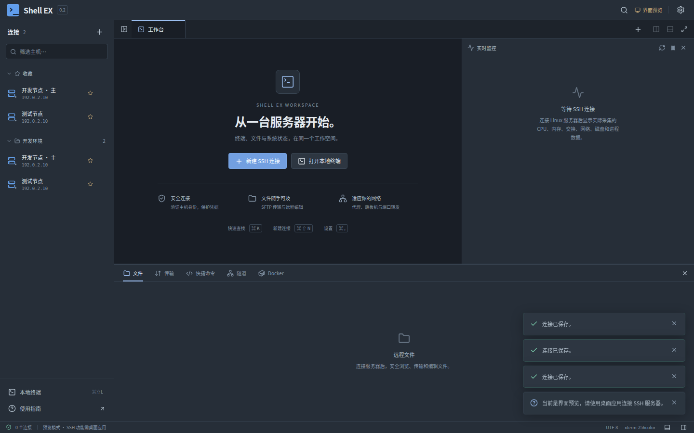
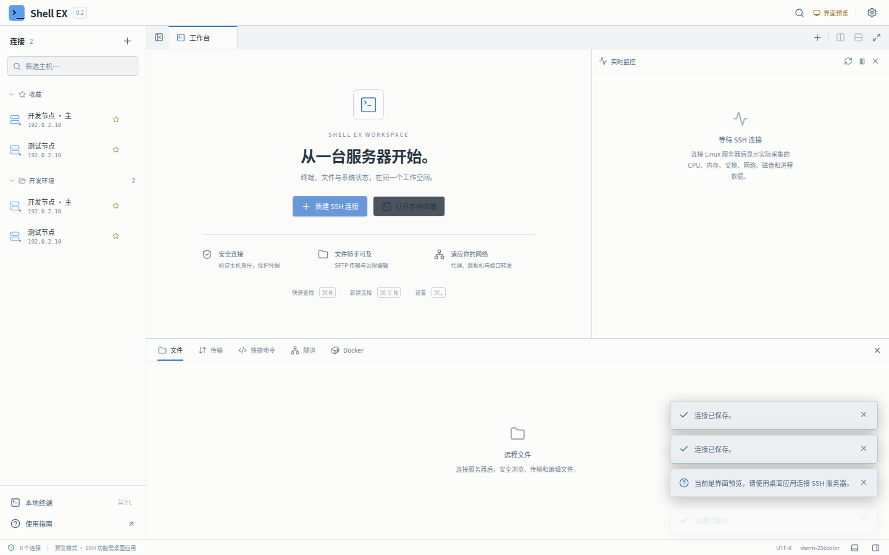
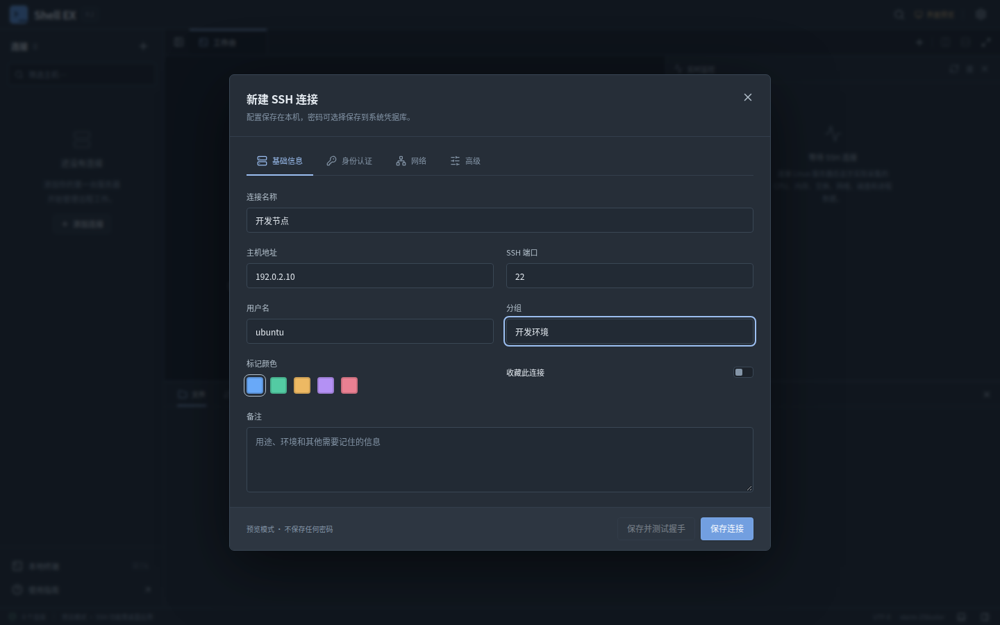
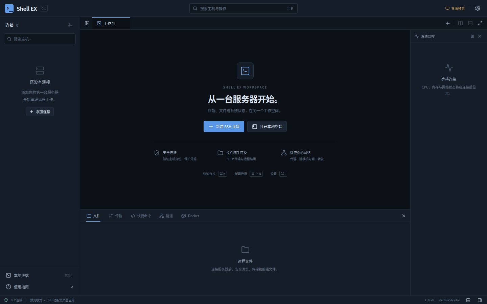
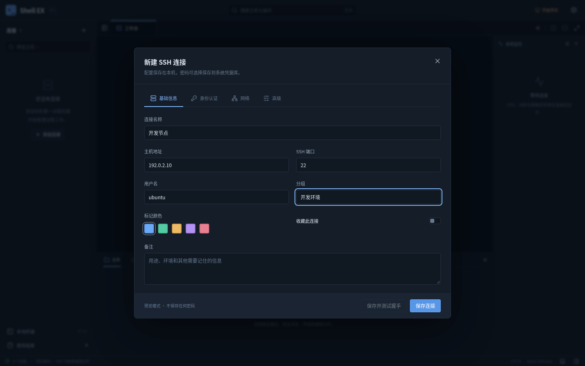
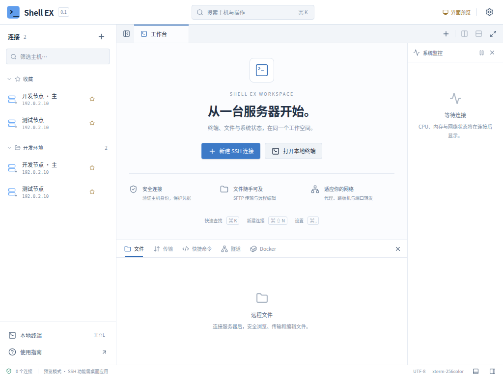

# Shell EX 界面规范

## 布局

v0.2.0 桌面工作台采用紧凑标题栏（搜索仅图标/⌘K）、左侧主机树、上方终端和右侧滚动监控、下方全宽可拖动 SFTP/工具面板。默认窗口 1440×920，最小 960×640。标题栏保留系统窗口控制。

主机侧栏默认约 232px，可拖动。文件面板默认约 326px 高，可拖动。终端得到剩余空间。专注模式收起侧栏、文件和监控；工具条可以恢复。隐藏终端保持实例与有界 scrollback，切换回来不丢失输出。

## 视觉系统

默认石墨灰（graphite），另有雾光浅色（mist）、极光深色（aurora）和兼容的经典浅色（light）。深色主背景接近 `#1d232b`，终端接近 `#191e26`，面板接近 `#262e38`，蓝色用于交互、绿色用于已连接、暖色用于需注意状态、红色用于错误与明确的破坏性操作。状态同时有文字和图标，不只依赖颜色。

按钮使用长方形及轻微圆角，常规 30–34px 高；主要操作单一强调色，图标按钮提供 tooltip 与 accessible name。输入、弹窗、菜单、表格与间距使用统一 CSS 变量。无远程字体、图片 CDN 或脚本依赖。

## 屏幕与交互

| 页面 | 核心设计 |
| --- | --- |
| 工作台 | 主机分组+搜索；会话标签，分屏/专注/面板按钮；连接状态明确 |
| 新建/编辑连接 | 基础信息、身份认证、网络、高级；保存/握手测试区分，不宣称探测通过就是登录成功 |
| 身份核验 | 展示地址、算法、SHA-256、旧指纹；用户明确勾选后才可信任，变化时使用警示文案 |
| 凭据与 MFA | 只显示当前连接请求；密码隐藏、不回显已存凭据；取消立即结束挑战 |
| SFTP | 路径、导航、搜索、列表、多选；危险操作确认；权限失败展示具体错误 |
| 编辑器 | Monaco 本地 worker，UTF-8 与大小限制；未保存标记、保存/另存为/重载；关闭或切换先处理草稿 |
| 传输中心 | 排队、校验、运行、暂停中、已暂停、验证、提交、完成、失败、取消中、取消均真实显示 |
| 目录传输 | 预览条目/大小/链接/冲突，跳过或覆盖；部分失败逐项列出 |
| 监控 | 首次 CPU 无差分时显示未知；网络根据采样差分显示速率；不伪造未采集数值 |
| 快捷命令 | 分类、模板文本编辑、插入终端；执行目标清晰 |
| 隧道 | 类型、绑定端口、目标、所在会话、停止；无公开地址默认绑定 |
| Docker | 容器与镜像页签；操作/日志显示；权限或 Docker 缺失时提示 |
| 设置 | 主题/字体/缓冲/采样/传输、凭据清除、备份与导入、更新状态 |

## 键盘与可访问性

`Cmd/Ctrl+K` 操作搜索；`Cmd/Ctrl+,` 设置；`Cmd/Ctrl+Shift+N` 新建连接；`Cmd/Ctrl+Shift+L` 本地终端；终端内 `Cmd/Ctrl+F` 搜索。编辑器保留常用保存与搜索操作。终端不拦截标准 Ctrl+C 中断命令。

弹窗 focus trap、Escape、焦点恢复和可访问标签共同支持键盘操作。多行粘贴默认确认；远程 OSC 52 不可静默访问本地剪贴板。

## 预览与验收

浏览器界面预览显式显示“界面预览”，默认没有主机，不提供伪造指标和成功状态。自动化验收只创建 `192.0.2.10` 等保留测试地址，不使用真实凭据。截图作为 CI 产物保存，主机测试数据不是实际服务器清单。

需核对 1440px 与 1024px 宽度、两套主题、表单和菜单、不出现页面级横向溢出、浏览器 console 无应用错误。桌面 WebView 的系统集成验收单独记录。

## v0.2.0 实际界面预览

以下截图来自 [Verify 45206580805 的 UI 作业](https://github.com/xzcode/shell-ex/actions/runs/45206580805)，代码提交 `f7c4d61f0bbea30b2251f051484a1852f0388be4`。这是 **浏览器预览模式**，没有连接真实服务器；截图中的 TEST-NET 主机只是测试数据。终端、SFTP 和监控的实际协议行为由独立 Linux/OpenSSH 组合测试验证。

### 石墨灰 · 上方终端和监控、下方全宽工具区

### 雾光浅色

### 连接窗口（输入框/下拉框统一高度）

## v0.1.0 历史界面截图

## 本次实现的实际截图

以下图片来自 [Verify 45173939448 的 UI 作业](https://github.com/xzcode/shell-ex/actions/runs/45173939448/job/137690213209)，源提交 `7c5b2e547dabb48de4d42cfd00ed4dde5181cf87`。采用 Chrome 与已安装的中文字体；均为实际页面截图，没有合成终端输出。浏览器预览保持未连接状态，真实 SSH/SFTP/Docker 另由核心集成测试验证。

### 深色工作台，1440 × 900

### 新建连接

### 浅色紧凑布局，1024 × 768

人工复核确认中文可读、弹窗没有裁切；交互测试同时确认主机新建/编辑/复制/收藏/筛选、预览凭据不落盘、预览禁止远程操作、主题与主机刷新后保留、1024px 无横向溢出及无未捕获页面错误。

该作业共运行并通过 2 项测试：工作台交互与截图验收，以及注入发送器、调度器的终端 ACK 行为测试。后者验证短暂故障后顺序恢复、重试耗尽、调用无响应的超时处理、取消后的定时器清理及迟到结果处理；它不替代桌面原生连接验收。

CI 明确安装 `fonts-noto-cjk`，避免英文 Runner 缺少中文字形造成方框。Linux DEB 同样声明中文字体依赖，应用本身不请求在线字体。
